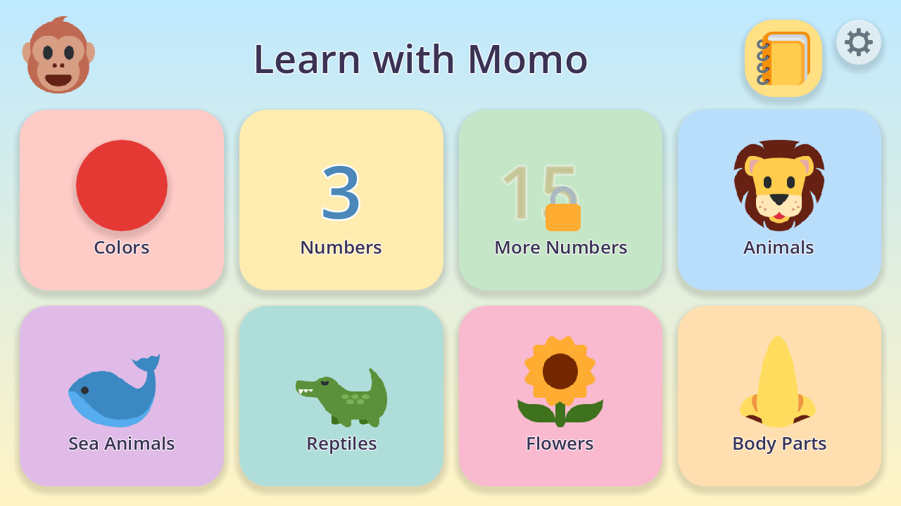
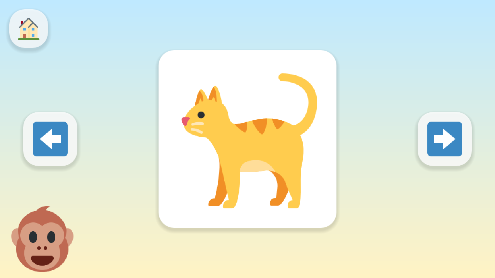
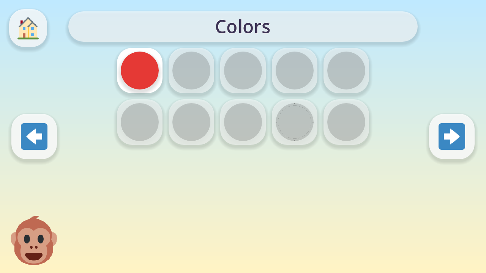

# Learn with Momo

**An offline Android learning game that teaches toddlers their first English words with a friendly monkey called Momo.**

Designed and developed by **[Hamza Pervaiz](https://www.linkedin.com/in/hamzapervaiz-dev/)**.



## About

Learn with Momo is built for children around 3 years old who cannot read yet. Every screen works with pictures, voice and big buttons, so a child can play alone or with a parent next to them. There are no ads, no in-app purchases, no internet access and no endless feed: just calm, clear English.

## Features

- **8 categories:** Colors, Numbers 1–10, More Numbers 11–20, Animals, Sea Animals, Reptiles, Flowers and Body Parts
- **Learn mode:** one big picture at a time with a clear spoken name ("This is a turtle.")
- **Play mode:** "Where is the turtle?" with 2–3 pictures. Wrong answers only get a gentle "Try again!"
- **Rewards:** stickers for every round won, a sticker album, and new outfits for Momo when a page is full
- **Parents area** behind a parent gate: a daily play time limit (Off / 10 / 15 / 20 / 30 min), extra minutes and progress reset
- **Fully offline:** the app asks for no permissions at all
- **Runs on low-end phones:** tested on a 2 GB RAM Android device
- **Data-driven content:** add a new category or word by adding data, without changing code

## Screenshots

| Learn mode | Sticker album |
|---|---|
|  |  |

## Tech stack

- [Godot Engine](https://godotengine.org/) 4.7, GDScript, Compatibility (GLES3) renderer
- [GUT](https://github.com/bitwes/Gut) for unit tests
- [Piper TTS](https://github.com/rhasspy/piper) for the pre-generated offline voice
- [Twemoji](https://github.com/jdecked/twemoji) for the artwork

## Project structure

```
data/      Categories, items and phrases (JSON)
scenes/    Screens: home, category, learn, play, reward, album, parents, time_up
scripts/   Core logic (content, progress, timer, parent gate, navigation) and UI helpers
assets/    Pictures, voice and sound effects
tests/     GUT unit tests
tools/     Asset scripts (fetch pictures, generate voice and sound effects, screenshots)
```

## Getting started

You need Godot 4.7, and for Android builds also JDK 17, the Android SDK and the Godot 4.7 export templates.

**Run the game:** open the folder in Godot and press Play.

**Run the tests:**

```bash
godot --headless --path . -s addons/gut/gut_cmdln.gd -gdir=res://tests/unit -gexit
```

**Build the Android APK:** set your keystore through Godot's environment variables, then export:

```bash
export GODOT_ANDROID_KEYSTORE_RELEASE_PATH="/path/to/your.keystore"
export GODOT_ANDROID_KEYSTORE_RELEASE_USER="your_alias"
export GODOT_ANDROID_KEYSTORE_RELEASE_PASSWORD="your_password"
godot --headless --path . --export-release "Android" build/learn-with-momo.apk
```

The APK is about 56 MB, supports Android 7+ and runs in landscape.

## Want a game like this?

I build custom educational and casual games for Android, for kids, schools, brands and businesses.

If you would like your own game, or a version of Learn with Momo with your language, characters or content, get in touch:

📧 **Email:** [hamzapervaiz276@gmail.com](mailto:hamzapervaiz276@gmail.com)<br>
💼 **LinkedIn:** [linkedin.com/in/hamzapervaiz-dev](https://www.linkedin.com/in/hamzapervaiz-dev/)

## Credits

Artwork, voice and sound credits are listed in [CREDITS.md](CREDITS.md).

## License

The code is released under the [MIT License](LICENSE) © 2026 Hamza Pervaiz. Artwork and voice files keep their own licenses, see [CREDITS.md](CREDITS.md).
